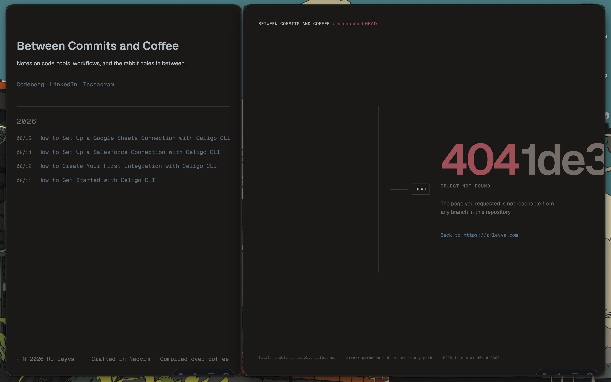

# Between Commits and Coffee

Personal blog. Markdown posts with YAML frontmatter are compiled to static
HTML by Astro and served from a Cloudflare Worker.

## Writing a Post

Drop a Markdown file in `src/content/posts`. Frontmatter needs `title`,
`description`, and `published`. `updated` is optional. Files in subdirectories
keep that path in the URL.

## Deployment

`pnpm build` renders the site into `dist`. `pnpm deploy` runs that build and
pushes it with Wrangler, which needs a Cloudflare account and credentials.

## License

Code is licensed under the MIT License. Blog content is copyright
© 2026 RJ Leyva and is not covered by the MIT License.
